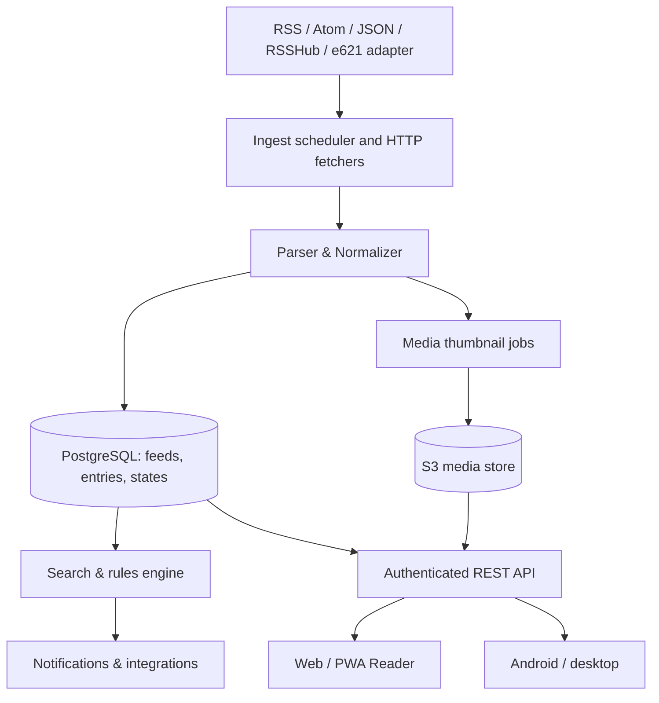

# Kamdar Reader 2.0 — realizační plán (produkt, architektura, UX/UI, QA)
**Datum:** 13. 11. 2026 · **Stav:** návrh, ne implementace · **Repo:** Kamdar-Wolf/e621-rss-gallery

## 0. Rozsah a definice cíle
Cílem je nezávislá univerzální RSS čtečka konkurující Inoreader/Folo v běžném čtení, správě odběrů, synchronizaci a multimédiích, odlišená důslednou obrazovou galerií a soukromím. Funkční parita není totožná s kopírováním proprietárního vzhledu, grafiky a zdrojového kódu. Úspěch vyžaduje samostatný server, databázi, spolehlivý ingest, zabezpečení a důsledné testování.

### Aktuální projekt
- `build_feed.py`, `tags.txt`: e621 Atom → RSS a úprava tagů;
- `cache_previews.py`: dávkové lokální náhledy e621;
- `public/reader/reader.js`, `reader.css`: funkční klient v prohlížeči, stavy v localStorage, galerie a OPML;
- `.github/workflows/publish.yml`: statická publikace na GitHub Pages.
- **Riziko:** CORS pro cizí RSS, žádná sdílená historie/DB, veřejný hosting obrazových náhledů, ruční struktura klienta.

## 1. Konkurence – mapování
Oficiální materiály:
- Inoreader: https://www.inoreader.com/features/ ; https://www.inoreader.com/features/rules ; https://www.inoreader.com/features/monitoring-feeds
- Folo: https://github.com/RSSNext/Folo ; https://github.com/RSSNext/Folo/wiki/Actions
- FreshRSS Google Reader API: https://freshrss.github.io/FreshRSS/en/developers/06_GoogleReader_API.html

**Must-have (P0):** RSS/Atom/JSON Feed, OPML, autodiscovery, adresář zdrojů, čtení s obrázky, read/unread/stars, deduplikace, sync, fulltext index načteného obsahu, ukládání stavu na backendu, offline posledních položek, bezpečné účty.
**Competitor-level (P1):** podcast/video reader, režim komiksů, pravidla s AND/OR/NOT, klientské i serverové filtry, výběrový archiv, full content, notifications, i18n, monitoring zdrojů, automatizované testy.
**Differentiators (P2):** pokročilá multimediální galerie, podobné/duplicitní obrázky, inteligentní dávkování, dobře ovládaná správa tagů e621, uložené dotazy, datové souhrny, AI/BYOK, text-to-speech.
**Enterprise/market expansion (P3):** multi-tenant hosting, placené plány, týmové prostory, externí API, web/no-feed monitoring ve velkém měřítku, fakturace, audit role.

## 2. Produktová mapa obrazovek
- Přihlášení / registrace / reset / 2FA / správa zařízení
- Onboarding: jazyk, téma, OPML, zdroje, první galerie
- Dashboard: dnešní souhrn, nové položky, prioritní zdroje, zdraví odběrů
- Feed workspace: sidebar složek a kanálů, list/karty/galerie, detailní reader
- Picture mode: masonry / rovnoměrná mřížka / full-size, rychlý lightbox, panorama, vícestránkové komiksy, next/previous
- Article mode: distraction-free reader, typography, zdroj/autor/čas, částečný/plný text, označování a poznámky
- Video/audio: metadata, inline přehrávače, podcast queue, pokračování, rychlost (dle média)
- Rules: trigger + nested conditions + actions, bezpečný preview/dry-run a historie
- Advanced search: filtrování podle zdroje, autora, média, datumů, full-text, tag, read state; uložené dotazy
- Collections: hvězdičky, štítky, „číst později“, offline balíčky
- Sources: add/edit/remove, discovery, import/export OPML, zdraví feedu, retry
- Settings: vzhled, klávesy, privacy, media handling, archiv, sync, export a delete
- Admin: health workerů, statistiky, rate limit, chyby a audit

## 3. UX/UI – návrhový systém
- **Značka** Kamdar Reader; vlastní identita a komponenty (ne pixelová kopie Folo/Inoreader).
- **Layout desktop** 3 panely: sidebar (256 px), timeline (flex 360–620 px), reader (flex min. 420 px); přepnutí do galerie přes celou šířku.
- **Tablet** volitelně 2 panely, detail jako overlay; **mobil** 1 panel se spodní navigací a full-screen reader.
- **Mřížky** galerie: 2–6 sloupců podle šířky, volba fit/cover, režim masonry a poměrů, virtuální načítání.
- **Základní design tokeny (návrh, nikoli finální testovaná paleta):** accent #729DFF; pozadí dark #0B101B, card #151F2F, surface #101725, border #283649, text #EDF3FC, secondary #96A5BA; light #F6F8FB/#FFFFFF/#152238. Kontrast ověřit na WCAG 2.2 AA.
- **Typografie:** Inter nebo systémový sans; obsahový režim volitelně serif; osnova velikostí 12/14/16/20/24/32; line-height článku 1.55–1.75.
- **Spacing:** 4px grid: 4/8/12/16/24/32/48; radii 8/12/16; touch target nejméně 44×44 CSS px jako návrhový cíl.
- **Stavy komponent:** idle, hover, focused, selected, unread, read, disabled, loading, error, offline, empty; skeletony, čitelné chyby, retry.
- **Navigace:** sidebar strom s počty, horní univerzální vyhledávání, context menu, keyboard shortcuts (j/k/o/m/s/b), command palette Ctrl+K.
- **Přístupnost:** WCAG 2.2 AA, viditelný focus, správné názvy ovládání, SR/keyboard testy, omezené animace, alt text, barevná nezávislost stavů.
- **České UX:** kompletní české řetězce, datumy, pluralizace, angličtina jako další jazyk, lokalizovatelné UI.

### Design deliverables
1. Inventory 30–50 opakovaných komponent;
2. Figma návrh tokenů a komponent (včetně specifikace kontrastů);
3. Wireframes: dashboard, timeline, galerie, detail, správce zdrojů, rules, settings;
4. High-fidelity desktop 1440px, tablet 768px, mobil 390px;
5. Interaktivní prototyp: import zdroje, náhled galerie, tagovací workflow, offline stav, chybové stavy;
6. Design QA s vizuální regresí a porovnáním vůči prototypu.

## 4. Doporučená technická architektura
**Pro finální produkt:** modulární monolit + oddělené background workery (nikoli předčasné mikroslužby).
- Web: React + TypeScript + Vite (moduly a route-based code splitting), TanStack Query, přístupné komponenty, CSS design tokens; testy Vitest + Playwright.
- API: Node.js LTS + TypeScript + Fastify (nebo NestJS pokud tým preferuje framework). OpenAPI dokumentace, validace schémat, autentizace prostřednictvím OIDC, rate limiting.
- DB: PostgreSQL pro všechny perzistentní entity; migrace DB, indexy, FTS, šifrované zálohy.
- Redis + BullMQ: fronty fetch/parse/media/rules/notification, retries, dead-letter jobs, per-origin limity.
- S3-kompatibilní objektové úložiště: pouze legálně a smluvně přípustné thumbnail cache, life-cycle TTL, limity velikostí.
- Reverse proxy + HTTPS + HTTP security headers + bezpečné cookies; monitoring metrik, logů, sentry-compatible exception tracking.
- Klient: PWA, IndexedDB cache, offline queue read/star; později Tauri (Windows) a Android wrapper nebo nativní klient dle výsledků testů.
- FreshRSS: **technický spike a kompatibilní backend adapter**, ne závazný základ pro dlouhodobý produkt; ověřit 37 zdrojů, GReader API, historii, rozšířitelnost. Vlastní datový model je nutný pro per-user multimediální metadata, metadata médií, pravidla a vlastní synchronizační konflikty.
- RSSHub: adaptér jen pro zdroje bez RSS a pouze pokud konkrétní trasy a licence dovolují provoz.

## 5. Datový model
- `users`, `sessions`, `devices`, `settings`
- `feeds` (URL, canonical URL, ETag, Last-Modified, next_fetch_at, error, content type)
- `subscriptions` (user_id, feed_id, folder_id, title override, notifications, refresh policy)
- `folders` (user_id, parent_id, order, name)
- `entries` (feed_id, GUID/canonical URL, title, author, published_at, updated_at, content HTML sanitized + plaintext, type, language, hash)
- `media` (entry_id, URL, local object key, mime, dimensions, sha256, status, rights/retention)
- `entry_states` (user_id, entry_id, read_at, starred_at, saved_at, version, updated_at)
- `labels`, `entry_labels`, `notes`, `annotations`
- `rules`, `rule_executions`, `notifications`
- `fetch_runs`, `audit_events`, `import_jobs`
Unique indexes on canonical feed URL and (feed_id, canonical entry ID). Pagination cursor, not unbounded offsets.

## 6. Ingestion engine
1. URL autodiscovery, redirect canonicalization, duplicate subscriptions;
2. per-origin concurrency and documented rate limits; conditional ETag/Last-Modified;
3. content-length bound, timeout, gzip, XML entity limits, UTF-8 handling, fetch retries/backoff+jitter;
4. sanitize HTML; preserve media enclosures, MediaRSS, OpenGraph when explicitly allowed;
5. dedup GUID, normalized URL and content hash; preserve edits and canonical article;
6. support failures (403, 404, 429, 5xx), show health warning rather than silent empty feed;
7. feed scheduling based on activity and publisher rules;
8. avoid bypassing access controls or hotlink protections; explicit source adapters rather than scraping shortcuts.

## 7. Media engine
- Derive thumbnail from media RSS/enclosures, HTML or site metadata in that order; source-adapter priority override.
- Multi-image item model: gallery (all assets), thumbnail (representative), dimensions/orientation.
- Variants: ~256px small, ~640px card, full-size original only when permitted.
- Image decoding and fallback, lazy load, progressive loading, responsive srcset, cache TTL and size budgets.
- Animated GIF/video preview with user setting to disable autoplay; comic sequence and lightbox keyboard/touch navigation.
- For e621: migrate tags.txt semantics into settings; retain Atom adapter as fallback; preserve rating and source attribution.
- **Legal/hosting gate:** thumbnail republishing requires review of source rights, platform terms and host AUP, particularly explicit media. Default to metadata+remote URL or private opt-in cache.

## 8. Rules / search / AI
- Rules schema: scope, triggers, nested ALL/ANY/NONE; actions mark read, star, tag, save, notify, webhook, copy; evaluation on new/updated entries.
- Must include dry-run and simulation without mutations, audit and retry, disable switch.
- Search: PostgreSQL FTS initially, later OpenSearch/Meilisearch if benchmarks demand; filters media, author, folders, read/stars and date; saved queries.
- AI: optional BYOK, provider abstraction, per-model token budget and explicit consent for sending article text; baseline works without AI; citations back to source links.

## 9. Auth, privacy, safety
- Private RSS/subscription visibility and media privacy by default; OIDC and passkeys/MFA; session invalidation and device inventory.
- Encrypt secrets in transit and at rest; never ship API credentials in static frontend.
- RSS fetchers and proxies are SSRF sensitive: deny loopback, private/link-local/internal addresses, DNS rebinding, unsafe redirects and unexpected schemes; cap sizes and timeouts; isolate egress.
- CSP, HTML sanitization, anti-XSS, CSRF, row-level authorization, rate limits, secure audit.
- Backups (encrypted) + restore exercises; retention and erase requests; opt-out from image caches where necessary.
- GitHub Pages only for demonstration, not confidential data or public adult-content thumbnail mirror.

## 10. Milestones and acceptance gates
| Stage | Indicative length (small team) | Deliverable | Gate |
|---|---:|---|---|
| 0 Audit/requirements/UX research | 2–3 weeks | current-state audit, competitor matrix, backlog, UI prototype | signed acceptance test plan |
| 1 Foundation | 3–4 weeks | modular front end, API, DB, auth, staging, CI/CD | migrations + login + integration tests |
| 2 Ingestion | 4–6 weeks | 37 feeds in backend, diagnostics, OPML, dedupe, search | >=95% reachable sources ingested, errors visible |
| 3 Synchronization/offline | 3–5 weeks | cross-device read/stars/labels, offline queue | two-device correctness and conflict tests |
| 4 Media/reader design | 4–6 weeks | polished reader layouts, multi-image/gallery/zoom/comics, accessibility | media fixture gallery, perf/accessibility criteria |
| 5 Automation & media player | 4–7 weeks | rule builder, safe dry-run, audio/video, notifications | end-to-end automated scenarios |
| 6 Hardening/beta | 4–6 weeks | monitoring, backup/restore, security + load tests, feedback | release gates and severity thresholds |
| 7 Advanced competitive features | continuing | AI, web monitoring, newsletters, browser extensions, native clients | dedicated quality, cost & compliance gates |

Stages have overlapping workstreams; rough **6–12 months for a focused 3–5 person team**, depending on depth. **Solo full parity more realistically 12–24+ months**. Estimates are planning ranges, not committed delivery dates.

## 11. Measurable release gates (targets to verify)
- **Data integrity:** zero known destructive sync bugs; 100% changes survive restart, backup/restore exercise passes.
- **Ingestion:** all 37 imported; each has explicit status, at least 95% of technically reachable feeds update over 24h; one bad feed never blocks others; no silent failures.
- **Images:** >=99% preview success on controlled, accessible media test fixtures; external access denials identified as such; gallery handles 500+ entries without blocking the browser.
- **UX:** common actions in <=3 interactions; WCAG 2.2 AA checks and keyboard scenarios; no horizontal overflow at 390px.
- **Performance:** target p95 API read <=300 ms (staging benchmark), p95 cached timeline render <=1 s after data are available, p95 input response <=100 ms on baseline device.
- **Sync:** read/star updates visible on another connected device within <=5 seconds at p95 when online; offline edits reconcile predictably after reconnect.
- **Reliability:** defined uptime SLO after beta (e.g. 99.5% monthly), monitored backups and recovery drills; crash-free sessions >=99.5% target.
- **Security:** threat model, dependency scanning, access-control integration tests, sanitization tests, no critical known vulnerabilities at release.

Targets must be adapted to actual deployment/testing hardware and legitimate provider limitations.

## 12. Sprint order – first 10 execution tasks
1. Capture data backup and pin current beta tag `v0.1`;
2. Extract product requirements and exact 37-feed fixture suite;
3. Build UI component inventory + reference wireframes + design tokens;
4. Bootstrap mono-repo with `apps/web`, `apps/api`, `apps/worker`, `packages/ui`, `packages/types`;
5. Provision PostgreSQL + Redis + private object storage in a development Docker Compose stack;
6. Create `/health`, identity/session, database migrations and test pipeline;
7. Implement a single normalized feed subscription/read API and external feed ingest with SSRF guards;
8. Build e621 adapter compatible with existing tags.txt and remote thumbnails;
9. Move read/star state to API with migration from localStorage and conflict policies;
10. Migrate old gallery into modular timeline/reader components and run desktop/mobile E2E regression.

## 13. Change-management
- Repositories/branches: main protected, dev integration, feature branches, PR+CI checks.
- Every feature has acceptance criteria, UI screenshots, automated tests, migration notes and rollback plan.
- Keep public demo stable during migration by exposing beta and next-version separate routes.
- Avoid premature commercialization until there is a signed-off content policy, security review and cost model.

## 14. Planning dependencies & cost bands
- Development: 3–5 people (1 backend, 1 frontend, shared UX/product, QA/DevOps part-time) for competitive release; 1 person will need materially longer.
- Infrastructure prototype: low tens of EUR/month may be possible for small private instance; stable public multi-user product requires substantially more and grows with image bandwidth, archives, AI and notifications.
- Largest uncertain costs: multimedia caching/egress, scraping changes and third-party API constraints, AI usage, abuse control, support/compliance.
- Choose hosting after testing legitimate source access; do not assume shared cloud IP addresses can always query e621/Reddit.

## 15. Explicit non-goals until foundation is done
- Pixel-exact duplication of rival branding/UI.
- Full automated monitoring of arbitrary third-party sites without rights review.
- Public adult-image hosting without policy and rights checks.
- Multi-tenant monetization, complex billing, large AI automation before reliable ingestion and synchronization.
